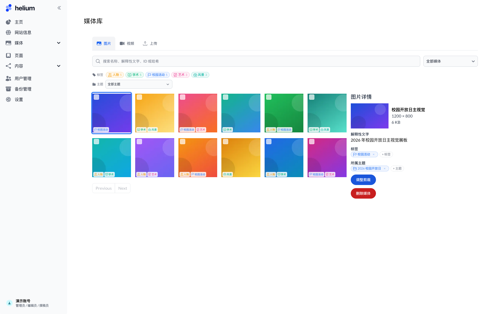
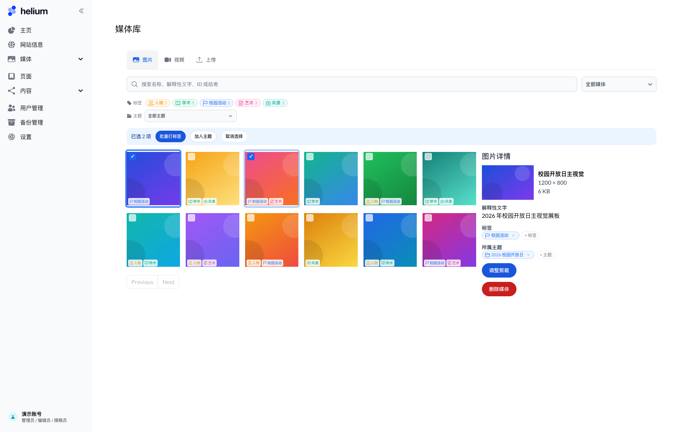
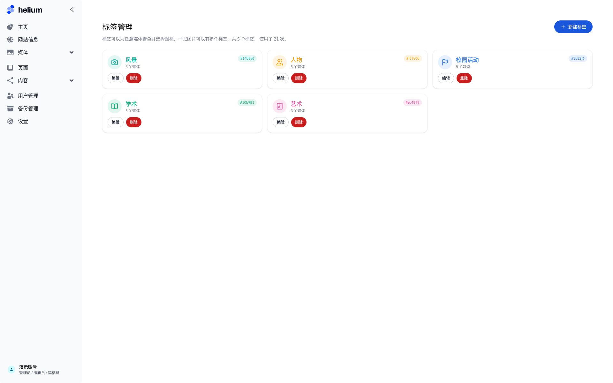
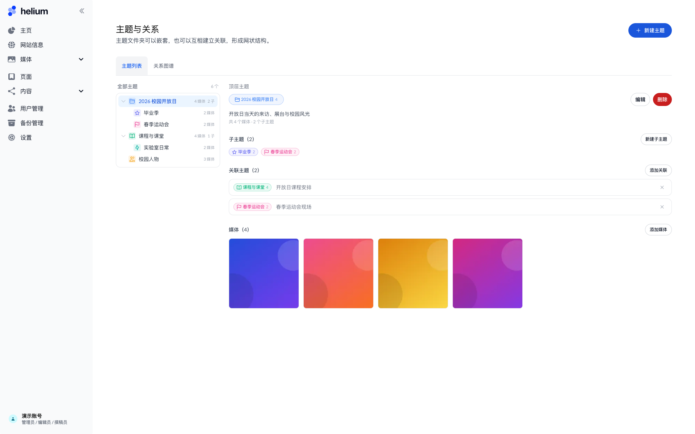
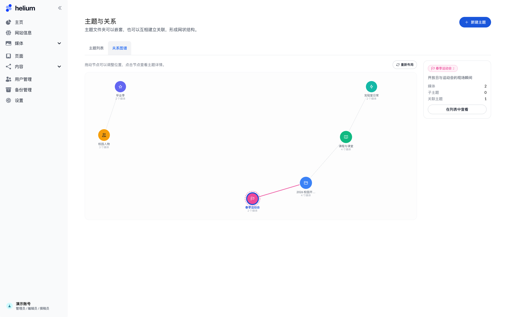

# Media taxonomy: tags, theme folders, and the relation graph

The Studio media library (`/studio/media`) is the central place for images and videos used across the website.
This feature adds two ways of keeping that library organized:

* **Tags** — free-form labels with a customizable name, color, and a single-color [Geist icon](https://vercel.com/geist/icons).
  A media item can carry any number of tags, and the library can be filtered by one or more tags at once.
  Tag chips inherit the tag color, so labels stay visually consistent in the grid, the filters, and the details panel.
* **Themes** — folder-like collections that can be nested to any depth. A theme can contain media and can be linked
  to other themes; links may carry a short description. The GitHub-style relation graph tab renders the resulting
  network of related topics as an SVG force-directed graph.

Tags and themes can be applied to a single item from its details panel, or to a whole selection at once (bulk tagging
and "add to theme"). Deleting a tag or a theme never deletes the media it was attached to. All taxonomy operations
require the `writer` role and are re-checked on the server.

## Screenshots

| Media library with filters and details | Bulk selection |
| --- | --- |
|  |  |

| Tag management | Theme list |
| --- | --- |
|  |  |

| Relation graph |
| --- |
|  |

## Data model

| Model | Purpose |
| --- | --- |
| `Tag` | `name` (unique), `color` (`#RRGGBB`), optional `icon` (Geist icon key). Joined to media through the implicit `_ImageTags` relation. |
| `MediaCollection` | Theme folder: `name`, `color`, optional `icon`, optional `description`, and a self-relation (`parentId`) for nesting. Media are joined through `_ImageCollections`. |
| `MediaCollectionLink` | A single directed row per related pair (`fromId`, `toId`, optional `label`). The UI treats links as undirected and reads them from both sides. |

## Code layout

| Location | Responsibility |
| --- | --- |
| `prisma/schema.prisma` | The three models above and the two new relations on `Image`. |
| `src/app/lib/services/media-taxonomy.ts` | Validation, permission checks, CRUD, bulk tagging, subtree resolution, relation creation/deletion. |
| `src/app/studio/media/taxonomy-actions.ts` | `'use server'` action layer. Expected validation failures are returned as `{ ok: false, message }` so production builds can display them. |
| `src/app/lib/services/media.ts` | `getMedia` gains `tagIds` / `collectionId` filters and returns each item's tags and collections. |
| `src/app/lib/media-taxonomy-icons.ts`, `src/app/studio/media/TaxonomyIcon.tsx` | Curated Geist icon keys shared by the server (validation) and the client (picker/rendering). |
| `src/app/studio/media/MediaLibrary.tsx` | Filter bar, bulk selection toolbar, and the tag/theme sections of the details panel. |
| `src/app/studio/media/TagManager.tsx`, `tags/page.tsx` | Tag management page. |
| `src/app/studio/media/ThemeManager.tsx`, `ThemeGraph.tsx`, `themes/page.tsx` | Theme tree, details, relations, and the relation graph. |
| `src/app/studio/media/*Dialog.tsx` | Tag editor, tag assignment (single/bulk), theme editor, theme picker, and bulk media picker. |
| `src/app/studio/StudioShell.tsx` | Sidebar group "媒体" with the media library, tag manager, and theme pages. |

## Database migration

The feature ships with a Prisma migration that only creates the new tables and relation tables; no existing data is
touched.

```bash
npm run db:migrate      # development: apply migrations
npm run db:deploy       # production: apply migrations
npm run db:generate     # regenerate the Prisma client
```

## Known limitations

* Tag and theme mutations are not written to `UserAuditLog` yet (image upload/delete and content publication are).
* Labels are single-language; a bilingual `nameEN` / `nameZH` pair can be added later if needed, following the
  `ContentEntity` convention.
* The taxonomy is not exposed through the integrated MCP server yet.
* The force-directed graph is tuned for a few dozen themes; very large numbers of themes may need clustering or a
  larger canvas.
